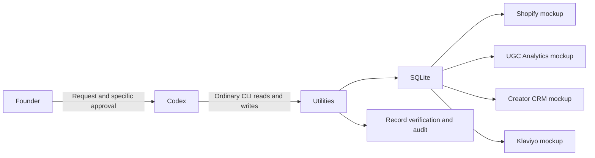

# Architecture

The sole AI interaction surface is the existing Codex conversation. The application has no model client, chat interface, LLM loop or autonomous agent service. FastAPI serves four minimal web interfaces backed by one database.

Relationships: creator → UGC post → campaign → traffic → attributed order → customer → segment → retention flow. Order-item cents reconcile to order totals; one last-touch attribution row per order agrees with the traffic campaign. Historical creator baselines exclude the latest post. Random seed 731 produces a reproducible 60-day fixture with variation. The 84k/12k outlier is intentionally seeded and subsequently calculated; it is not a claim of discovered real business performance.

Subscriptions are order flags, not billing. Revenue excludes tax, refunds and shipping. Flow engagements are synthetic fixtures; flow-specific revenue is not inferred from campaign totals. Page conversion comparisons have channel/intent confounds; proposed tests do not promise lift. Priority scores use a disclosed qualitative impact/confidence/urgency/effort rubric, not forecast dollars.

Codex authors proposal JSON. Preparation validates and freezes it with SHA-256. The explicit user reply approves selected IDs; execution checks approval, writes transactionally and uses unique IDs/completed-state checks against duplication. Failure rolls back; an approved transaction can be retried. Read-only verification checks every field. This is a trusted local demo, not multi-user authentication: someone with filesystem access can invoke the CLI.

Bubblewrap runs the service with separate user/PID/mount namespaces, mapped unprivileged UID, dropped capabilities, read-only source and project-data-only writes. The browser uses an independent disposable profile and enabled Chromium sandbox. Service bind: 127.0.0.1:8775. Host networking is shared; outbound network isolation is not claimed. No credentials, browser profile, container socket, physical network configuration, cloud resource or scheduled job is needed.

Tested environment: Debian 13, Python 3.13, x86-64. Other operating systems, live integrations and production deployment are untested. Bootstrap needs package-download access; business runtime does not depend on an external service.
