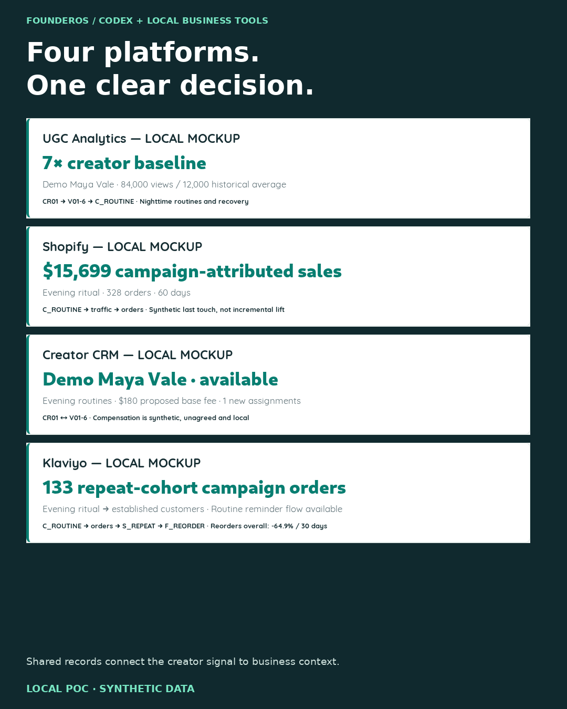
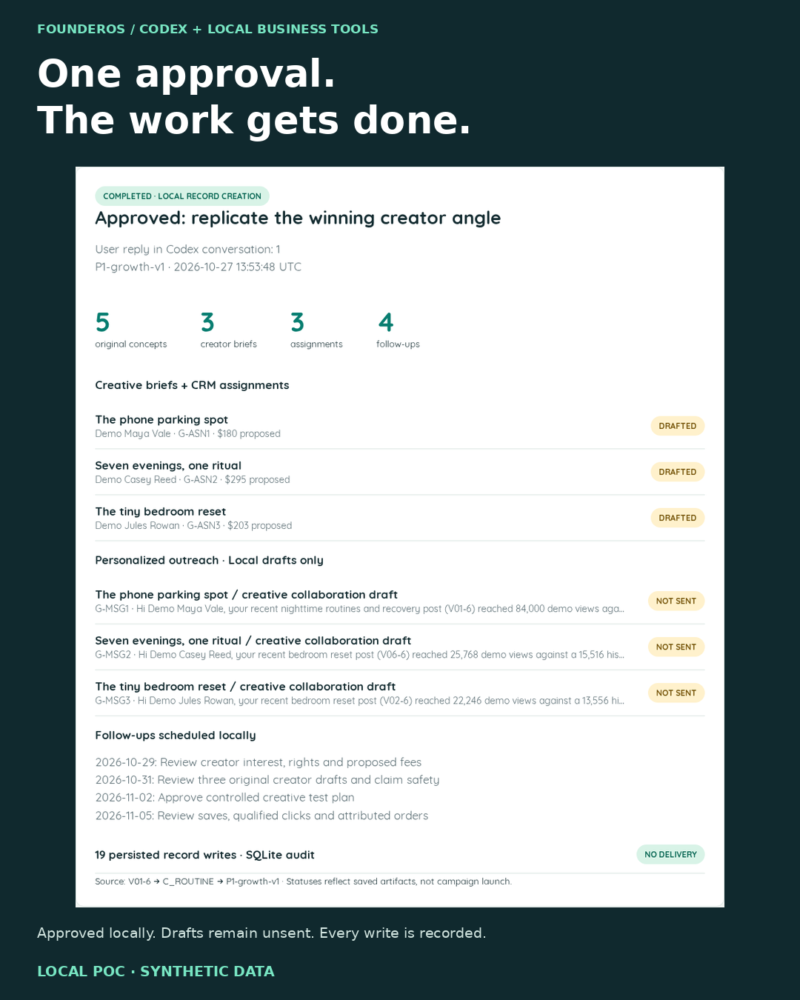

# FounderOS — less app management, more decisions

**Give Codex access to connected business tools, ask what matters, approve the work.**

This functioning local proof of concept shows a founder workflow across ecommerce, UGC, creator management and lifecycle marketing. Codex is the assistant. The four web interfaces are its business tools—there is no separate chatbot or agent backend.

**LOCAL POC · SYNTHETIC DATA · NO LIVE INTEGRATIONS**

## See the proof

| Connect the business data | Approve the next move |
| --- | --- |
| [](screenshots/02-multiplatform-intelligence.png) | [](screenshots/03-approved-execution.png) |

These are annotated **real browser captures**, not generated UI illustrations. Open either image for the full 1080×1350 version. [Untouched originals](screenshots/originals/) and [screenshot provenance](screenshots/MANIFEST.json) are included.

## The connected demonstration

1. **Ask Codex:** “Give me my morning brief.”
2. **Inspect:** Codex reads shared sales, creator, customer and retention records using ordinary local utilities.
3. **Decide:** it flags a creator outlier, a conversion gap and a declining repeat-customer cohort. [Read the actual brief](docs/DAILY-BRIEF.md).
4. **Approve:** the user replied **`1`**, approving only the proposed creator workflow.
5. **Execute and verify:** 19 real local database records were created: **five original concepts, three creator briefs, three personalized outreach drafts, three assignments, one test plan and four follow-ups**.
6. **Repeat safely:** running the completed workflow again created **zero duplicate records**.

Creative is **DRAFTED**, assignments/tasks are **PENDING**, messages are **NOT SENT**. “Completed” means the approved local records were created and verified; no campaign launched and no creator was contacted. [Inspect the record-by-record verification](evidence/verified-execution.json).

## What is underneath

| Local tool mockup | Working capabilities |
| --- | --- |
| Shopify | Orders, products, customers, revenue trends, attribution, landing-page comparisons, local experiment drafts |
| UGC Analytics | 72 posts, 12 fictional creators, historical baselines, creative hooks, ranking and saved test concepts |
| Creator CRM | Creator directory, personalized briefs, proposed assignments/fees, unsent outreach and follow-up tasks |
| Klaviyo | Cohorts, engagement fixtures, lifecycle flows, audience definitions, draft email/retention experiments |

One FastAPI application, SQLite and minimal HTML/CSS/JavaScript. Foreign keys connect creator → post → campaign → traffic → order → customer → segment → lifecycle flow. Financial arithmetic and comparisons are deterministic. Codex interprets the results and authors the work; the application makes no model/API calls.

The fictional **EVENFALL** scenario uses 60 synthetic days, 959 orders and 120 synthetic customers. A deliberately seeded example has 84,000 views versus a preceding-post average of 12,000. Analysis computes the 7× comparison from records. Every order total and single-touch attribution record reconciles. Attribution is association, **not incremental lift**. Nothing here represents actual NOKT, Happy Labs or Lucas Hazan business data, tool choices, endorsements or results.

## Run locally

Tested on Debian 13 / Python 3.13 with Bubblewrap and Chromium sandboxing available. Existing prerequisites: `python3`, `curl`, `bwrap`, compatible Linux libraries. No paid account, external credentials, Docker daemon or model key is required.

```sh
./tools/bootstrap.sh
./tools/start.sh
```

Open **http://127.0.0.1:8775/shopify-demo**, then switch tools from the sidebar. The other routes are `/ugc-demo`, `/creator-crm-demo` and `/klaviyo-demo`. Stop with Ctrl-C.

Bootstrap downloads Python packages and Chromium into this checkout. The service is localhost-only, with Bubblewrap user/process/filesystem namespaces and dropped capabilities. Source is read-only; project data is writable. Networking is shared so the host can reach localhost; **no egress firewall is claimed**. A Python venv alone is not OS isolation. These controls and Linux dependencies are described in [ARCHITECTURE](ARCHITECTURE.md).

A fresh clone seeds the business dataset and leaves all work unapproved. Included screenshots and evidence record the actual completed demonstration. [DEMO.md](DEMO.md) explains how to reproduce it with fresh, deliberate approval; it never silently replays someone else's approval.

## Verification and scope

The original lab passed **28 automated tests, 12 post-approval browser checks and five archive/restore checks**. The public export is separately checked; see [VERIFICATION.md](VERIFICATION.md).

Real production integrations, real sends, hosting, billing and multi-user authentication are outside this disposable proof of concept. A session using actual business tools would begin by selecting the workflows, access permissions and approval boundaries together.
